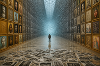
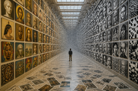

# 1. Termo-chave e revisão do semestre

Ao revisitar os conteúdos do semestre, identificamos quatro termos que se cruzam o tempo todo:

- **Visualidade**: o ver como algo construído pela história, pela cultura e pela técnica, e não só pela biologia do olho.
- **Museu do Imaginário**: para André Malraux (1947), a reprodução fotográfica reúne obras de todas as épocas e lugares num "museu sem paredes", que só existe nos livros e na imaginação de quem os folheia.
- **Semiótica**: na tríade de Peirce (ícone, índice e símbolo), a fotografia é *índice*, porque guarda um vestígio físico do real.
- **Memória Artificial**: das "artes da memória" da Antiguidade, com seus palácios mentais de lugares e imagens, aos arquivos técnicos e bancos de dados.

Escolhemos **Museu do Imaginário** como termo central porque ele articula os outros três. Também nos parece que a IA generativa realiza, de forma radical, o que Malraux previu.

# 2. Conceito central: quando o Museu do Imaginário começa a sonhar

Malraux percebeu que a fotografia mudava a história da arte. Na página do livro, uma moeda, um afresco e uma catedral aparecem no mesmo tamanho. A reprodução tira as obras de seus contextos, iguala suas escalas e as transforma em "estilos" comparáveis. O museu deixa de ser um edifício e vira um álbum.

A IA generativa leva esse gesto ao limite. Os modelos de difusão são treinados com bilhões de reproduções de imagens e as convertem num **espaço latente**: uma memória estatística que não guarda nenhuma obra em particular, só os padrões de todas elas. Para criar uma imagem nova, o modelo parte de **ruído puro** e o "limpa" passo a passo até que uma forma apareça.

Daí a ideia que queríamos comunicar:

> **O Museu do Imaginário deixou de ser um álbum e virou um espaço latente: um museu que já não exibe obras, mas as dissolve em ruído e as faz renascer como variações.**

# 3. A imagem

{width=15cm}

Um corredor de museu neoclássico, aparentemente infinito, em perspectiva central. As paredes estão cobertas do chão ao teto, à moda dos antigos salões, por molduras douradas idênticas. Nelas há bustos gregos, ícones bizantinos, figuras egípcias e retratos de várias tradições. Perto de nós, as obras são coloridas e nítidas. À medida que o corredor se aprofunda, elas perdem matéria, viram partículas e se desfazem numa névoa de ruído cinza-azulado que brilha no ponto de fuga. No primeiro plano, dezenas de fotografias em preto e branco de obras de arte cobrem o piso de mármore. Um único visitante, de costas e pequeno, olha para o ruído.

O corredor pode ser lido em dois sentidos, e essa ambiguidade é intencional:

- **Do primeiro plano para o fundo**, é a história do arquivo: a obra vira fotografia (o museu de Malraux), a fotografia vira pixel (o arquivo digital) e o pixel vira ruído (a memória da máquina). É uma memória que esquece.
- **Do fundo para o primeiro plano**, é o processo de difusão: as imagens nascem do ruído e ganham forma à medida que se aproximam. É uma memória que inventa.

# 4. Relações com o termo-chave e com outros conceitos da disciplina

**Museu do Imaginário (Malraux).** As molduras idênticas e o tamanho uniforme das obras representam a equivalência que a reprodução impõe: culturas e séculos diferentes postos lado a lado num encontro impossível fora do álbum. As fotografias espalhadas no chão homenageiam a célebre foto de Maurice Jarnoux para a *Paris Match*, em que Malraux escolhe, no chão de casa, as pranchas fotográficas do seu livro. O museu imaginário começa no chão, como montagem.

**Memória Artificial.** O corredor funciona como um *palácio de memória* da tradição retórica estudada por Frances Yates: lugares (*loci*) onde se depositam imagens (*imagines*) para lembrar. Também lembra o *Atlas Mnemosyne* de Aby Warburg, em que reproduções fotográficas montadas em painéis revelavam a "sobrevivência" das imagens ao longo do tempo. Na imagem, porém, a memória é maquínica: quanto mais fundo, menos ela guarda obras e mais guarda padrões. O espaço latente é uma memória sem lembranças específicas.

**Semiótica.** A imagem percorre a passagem do *índice* ao *ícone*. A fotografia é índice, o "isso foi" de Barthes. A imagem de IA é ícone puro: tem semelhança, mas nenhum contato físico com um referente. A própria imagem que produzimos é um exemplo disso. É fotorrealista, parece uma fotografia, e no entanto esse corredor nunca existiu: *parece ter sido, mas nunca foi*.

**Visualidade.** Escolhemos a perspectiva central renascentista, que Panofsky chamou de "forma simbólica", porque é o regime visual que organizou o olhar ocidental por séculos. Na nossa imagem, todo esse sistema conduz o olhar para um ponto de fuga que agora é ruído. É a passagem de uma visualidade perspectiva para uma visualidade algorítmica.

# 5. Escolhas estéticas

| Escolha | Intenção |
|---|---|
| **Fotorrealismo** | Fazer a imagem encenar o próprio problema semiótico: ter aparência de índice sem ser índice. |
| **Perspectiva central e simetria** | Citar a visualidade clássica e dirigir o olhar ao ruído. |
| **Gradiente quente → frio** (ouro e ocre → cinza e ciano) | Passar da matéria, da tradição e da "aura" (Benjamin) para a tela e o dado. |
| **Molduras douradas idênticas e pendura "estilo salão"** | Mostrar a institucionalização, a equivalência e o excesso de imagens da cultura contemporânea. |
| **Visitante de costas e pequeno** | Usar a *Rückenfigur* de Caspar David Friedrich: o espectador entra na cena pelo corpo do personagem. A escala humana diante da escala do arquivo. |
| **Fotografias no chão** | Representar o momento da reprodução e da montagem: o álbum de Malraux ainda em construção. |
| **Luz que vem do ruído** | No fundo, a luz deixa de vir da claraboia e passa a vir da nuvem de dados, como uma tela. |

# 6. Processo e "comandos" usados

**Ferramenta:** gerador de imagens por IA do **Canva**, no modo texto → imagem. **Parâmetros:** proporção 3:2 (paisagem), estilo fotorrealista, duas iterações. Escrevemos os prompts em inglês porque os modelos são treinados majoritariamente com legendas em inglês e respondem com mais precisão; a tradução de cada prompt vem logo depois dele.

**Passo 1. Mapa conceitual.** Partimos do termo (Museu do Imaginário), passamos pelo conceito (o espaço latente como museu) e chegamos aos elementos visuais: corredor infinito, molduras iguais, gradiente de dissolução, ruído no fundo, fotos no chão e visitante.

**Passo 2. Prompt da versão 1.**

> *Photorealistic wide-angle view of an endless neoclassical museum gallery in one-point perspective. The walls are covered floor to ceiling, salon-style, with hundreds of framed artworks from every culture and era, all displayed at the same size: a Greek marble head, a golden Byzantine icon, an Egyptian profile, a Japanese ukiyo-e print, an African mask, a Renaissance portrait, Marajoara ceramic patterns, a Brazilian modernist landscape. Near the viewer the artworks are sharp and in full color; further down the corridor they gradually become black-and-white photographic reproductions, then halftone dots and pixels, and at the vanishing point everything dissolves into pure gray digital noise, like TV static. Loose photographs are scattered across the polished marble floor in the foreground. A single small visitor stands in the middle of the corridor, seen from behind, looking into the noise. Soft daylight from skylights, warm ochre and gold tones in front fading to cold gray and cyan in the distance. Cinematic, highly detailed, contemplative mood.*

Tradução: "Vista fotorrealista em grande angular de uma galeria de museu neoclássica sem fim, em perspectiva central. As paredes são cobertas do chão ao teto, em estilo salão, por centenas de obras emolduradas de todas as culturas e épocas, todas no mesmo tamanho: uma cabeça grega de mármore, um ícone bizantino dourado, um perfil egípcio, uma gravura ukiyo-e, uma máscara africana, um retrato renascentista, padrões de cerâmica marajoara, uma paisagem modernista brasileira. Perto do observador as obras são nítidas e coloridas; mais adiante viram reproduções fotográficas em preto e branco, depois retícula e pixels, e no ponto de fuga tudo se dissolve em ruído digital cinza, como chuvisco de TV. Fotografias soltas espalhadas no piso de mármore polido em primeiro plano. Um único visitante pequeno, de costas, no meio do corredor, olhando para o ruído. Luz suave de claraboias; tons quentes de ocre e ouro na frente, passando a cinza frio e ciano ao fundo. Cinematográfico, muito detalhado, clima contemplativo."

{width=11cm}

**Avaliação da versão 1.** A versão acertou o corredor, as claraboias, o visitante, as fotos no chão e a pendura em salão. Houve três problemas:

a) A IA organizou a transformação **na horizontal** (parede esquerda colorida, parede direita em preto e branco e pixelada), e não **em profundidade**, como queríamos.

b) O fim do corredor virou uma névoa clara, e não o ruído que representa o espaço latente.

c) Quase todas as obras viraram **retratos de rostos**. Pedimos "todas as culturas" e recebemos uma galeria homogênea.

**Passo 3. Prompt da versão 2 (final).** Reescrevemos o prompt deixando explícito o eixo da transformação e o papel do ruído:

> *Photorealistic cinematic photograph, symmetrical one-point perspective, of an infinitely long neoclassical museum corridor. Both walls are covered floor to ceiling, salon-style, with identical gilded frames holding artworks from many cultures and eras, all at the same size: Greek marble sculpture, golden Byzantine icon, Egyptian relief, Japanese woodblock print, African mask, Renaissance portrait, Indigenous Marajoara pottery, Brazilian modernist painting. The transformation follows the depth of the corridor: in the foreground the artworks are vivid, full-color and sharp; in the middle distance they become faded black-and-white photographic reproductions; further away they break apart into halftone dots and square pixels; the far end of the corridor is a glowing wall of dense gray-and-cyan digital noise, grainy static from which faint fragments of images are just emerging. Dozens of black-and-white photographs of artworks lie scattered across the polished marble floor in the foreground, as if someone were assembling an album. One small solitary visitor stands in the center, seen from behind, facing the noise. Soft skylight, warm ochre and gold in front, cold desaturated gray and cyan at the back. Highly detailed, contemplative, melancholic atmosphere.*

Principais mudanças e por quê:

- **"The transformation follows the depth of the corridor"**, com as etapas em ordem (*foreground → middle distance → further away → far end*): para corrigir o eixo da transformação.
- **"Glowing wall of dense gray-and-cyan digital noise… from which faint fragments of images are just emerging"**: para que o fundo representasse o ruído da difusão, de onde as imagens nascem.
- **"Identical gilded frames"** e **"symmetrical"**: para reforçar a equivalência de Malraux e a ordem perspectiva.
- **"As if someone were assembling an album"**: para dar sentido às fotos no chão.
- **"Melancholic"**: para incluir a dimensão da perda (memória e aura).

**Resultado.** A transformação passou a acompanhar a profundidade. O fundo virou uma nuvem luminosa de partículas cinza-azuladas que desmancha as próprias paredes. As molduras ficaram douradas e uniformes, e o piso se encheu de fotografias em preto e branco. Escolhemos esta versão como final e não fizemos edição posterior, para manter a transparência do processo.

# 7. Reflexão crítica sobre o resultado

**A imagem é metalinguística.** Ela foi produzida pelo mesmo processo que representa: para desenhar um "museu latente", o modelo recorreu ao seu próprio museu latente. A obra é, ao mesmo tempo, representação e exemplo do conceito.

**O prompt é tradução, não comando.** Na versão 1, a máquina entendeu "mais adiante no corredor" de outro modo e distribuiu a transformação entre as paredes. Isso mostra o intervalo entre signo verbal e signo visual, aquilo que Julio Plaza chama de *tradução intersemiótica*. Com Flusser, percebemos que não "comandamos" o aparelho: jogamos com o seu programa, explorando possibilidades que ele já contém, e a caixa-preta continua opaca.

**O viés do arquivo apareceu, e decidimos não escondê-lo.** Mesmo pedindo obras de "todas as culturas", o modelo insistiu em rostos e emoldurou tudo numa arquitetura neoclássica europeia com molduras douradas. Os bancos de imagens usados para treinar esses modelos são dominados por referências ocidentais, e isso aparece no resultado. Esse limite reforça o conceito em vez de enfraquecê-lo. O museu imaginário de Malraux também era eurocêntrico: o "recipiente universal" sempre pertence a uma cultura específica. O museu sem paredes ainda tem paredes: **as paredes do dataset**.

**Autoria e curadoria.** O conceito, as referências, as escolhas e a seleção final são nossas; a execução é estatística. O papel de quem cria se aproxima do de um curador, que é exatamente o papel de Malraux: ele não pintava, selecionava e aproximava imagens.

**Limites técnicos.** Não houve controle fino. Não foi possível escolher obras específicas, e elas não são identificáveis. Isso também é coerente com o conceito, porque o espaço latente não guarda obras, guarda estilos. Uma próxima etapa poderia usar ferramentas com mais controle (imagem de referência, *inpainting* ou *seeds* fixas) para diversificar os tipos de objeto nas paredes.

# Referências

BARTHES, Roland. *A câmara clara: nota sobre a fotografia*. 1980.

BENJAMIN, Walter. A obra de arte na era de sua reprodutibilidade técnica. 1936.

FLUSSER, Vilém. *Filosofia da caixa preta: ensaios para uma futura filosofia da fotografia*. 1983.

MALRAUX, André. *O Museu Imaginário*. 1947.

PANOFSKY, Erwin. *A perspectiva como forma simbólica*. 1927.

PEIRCE, Charles Sanders. *Semiótica*. São Paulo: Perspectiva.

PLAZA, Julio. *Tradução intersemiótica*. São Paulo: Perspectiva, 1987.

WARBURG, Aby. *Atlas Mnemosyne*. 1924–1929.

YATES, Frances. *A arte da memória*. 1966.
